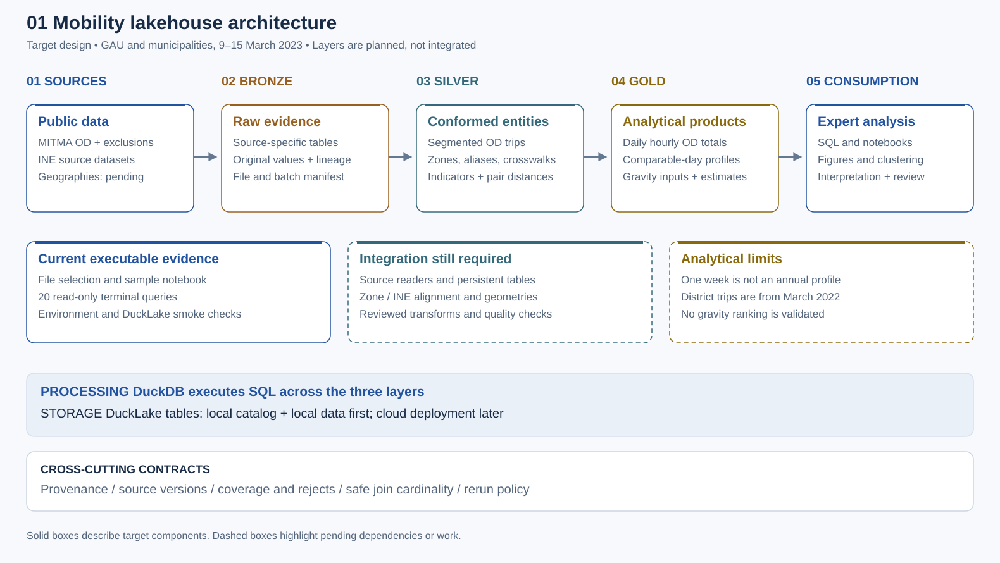
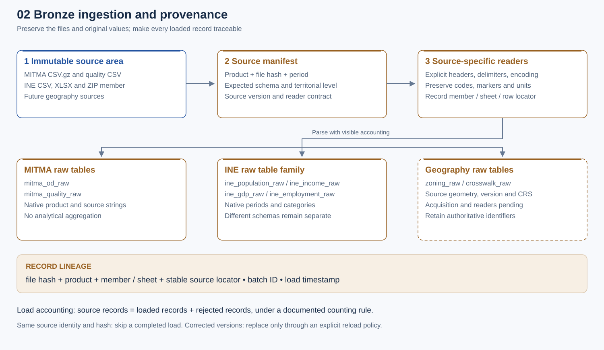
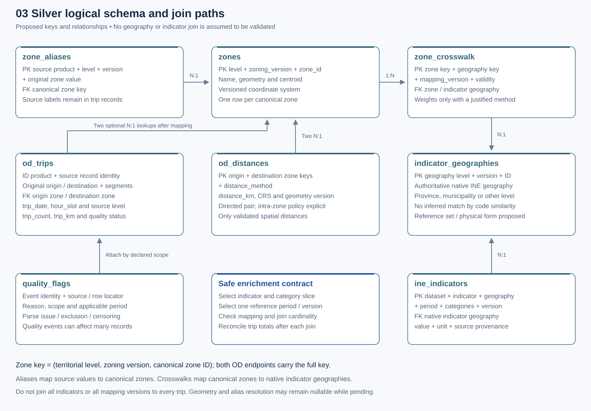
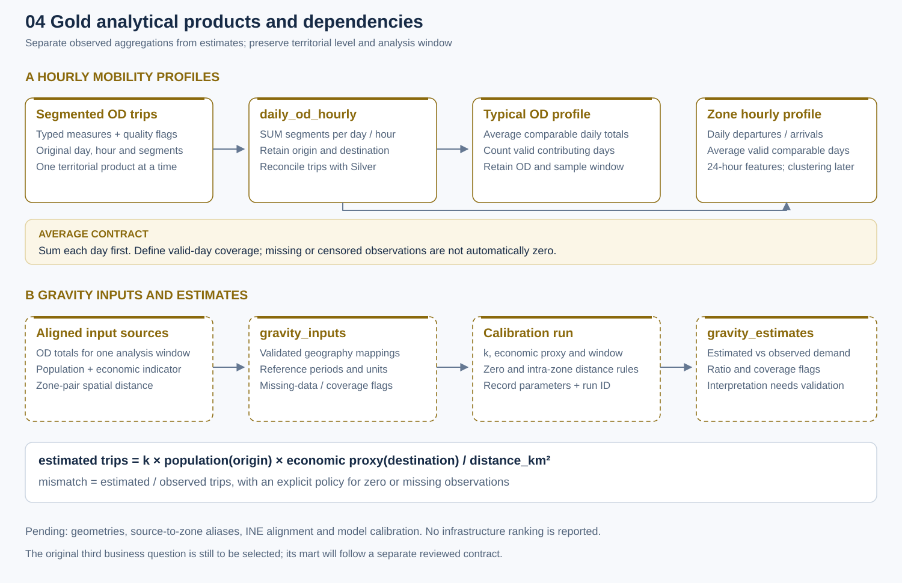

# Mobility lakehouse architecture

Sprint 1 review · Group 10 · 9 November 2026

We propose a three-layer lakehouse that preserves public mobility sources,
models trips and territorial reference data separately, and produces hourly
mobility profiles and inputs for a gravity model. DuckDB performs SQL
processing; DuckLake is the target storage and table-management layer.

The review sample is **9–15 March 2023, GAU and municipalities processed
separately**. The environment and source exploration are available. Persistent
analytical layers and end-to-end integration remain pending.

## Reading guide

1. [Scope and evidence](#1-scope-and-evidence).
2. [System architecture](#2-system-architecture).
3. [Sources and territorial alignment](#3-sources-and-territorial-alignment).
4. [Bronze](#4-bronze-preserving-source-evidence): ingestion and provenance.
5. [Silver](#5-silver-modelling-trips-and-reference-data): entities, keys and joins.
6. [Gold](#6-gold-building-analytical-products): output contracts.
7. [Execution and validation](#7-execution-storage-and-validation).
8. [Decisions and review narrative](#8-decisions-and-review-narrative).

## 1. Scope and evidence

| Area | Available evidence | Remaining work |
|---|---|---|
| Source organization | Received files now reside in `project/DATA`; seven files for each selected MITMA product | Full-file coverage and methodology inventories |
| Local selection | `config/datasets.local.toml` points to `../DATA/MITMA 9_03-15_03`, GAU, 9–15 March 2023 | Each teammate configures their data root |
| Environment | Setup, environment checker and DuckLake smoke-check code exist | Rerun full verification in the presentation environment |
| Source exploration | Notebook and 20 terminal queries; all 20 ran on 1,000 source records, daily totals also ran on the complete GAU file for 9 March | Full validation of the agreed week and both levels |
| Architecture | Proposed table contracts and four SVG figures | Implement persistent analytical layers |
| Analytical outputs | Source-level SQL examples | Validated profiles, clustering and gravity estimates |

A smoke test demonstrates component operation. A source query demonstrates
file reading and aggregation. Neither establishes completion of persistent
Bronze → Silver → Gold transformations. The original Sprint 1 brief includes
tested proof-of-concept transformations; that requirement remains outstanding.

## 2. System architecture



*Figure 1. Target architecture. Shared contracts preserve provenance and
quality. Dashed panels highlight pending work; the flow is a design.*

The source area holds unchanged downloads. Bronze adds controlled tabular
ingestion and lineage. Silver assigns types and meaning while separating
trips, zones, indicators and distances. Gold produces declared-grain
analytical datasets. Each layer has a distinct responsibility.

| Layer | Main question | Representative row | Intended output |
|---|---|---|---|
| Bronze | What exactly did the source supply? | An original MITMA segment record with source identity | Raw tables and ingestion manifest |
| Silver | What does it mean and how can it join safely? | A typed segment record with source and optional resolved zone references | Facts, reference entities and quality events |
| Gold | What observation or estimate will an analyst consume? | An hourly OD total for one date, level and version | Analytical marts with coverage information |

The local target is DuckDB processing with a local DuckLake catalog and data
files. The later cloud target uses Neon/Postgres for the catalog, S3 for table
data, AWS Batch for execution and Airflow for orchestration, following the
project brief. No cloud deployment is claimed here.

## 3. Sources and territorial alignment

### 3.1 Received sources

The original download parts contained 36 distinct files: 28 MITMA files, four
INE files and four Word proposals. Consolidation verified file hashes after
moving. Following the subsequent folder rename, the current location is
`project/DATA`. No row-level deduplication was performed.

| Source | Received coverage / form | Use and limitation |
|---|---|---|
| MITMA GAU trips | Seven CSV.gz files, 9–15 March 2023 | Selected prototype product |
| MITMA municipality trips | Seven CSV.gz files, 9–15 March 2023 | Selected product; separate from GAU |
| MITMA district trips | Seven CSV.gz files, 9–15 March 2022 | Outside the aligned 2023 sample |
| MITMA district exclusions | Seven CSV files, 9–15 March 2023 | Verify applicability before use |
| INE population | `00nacional_2022.zip`, microdata in alternative formats | Choose one representation; verify geography and reference year |
| INE income | `30824.xlsx` | Inspect worksheet structure, geography, units and years |
| INE GDP | `80109.csv`, provincial values and multiple periods | Select magnitude, geography and year |
| INE employment | `65349.csv`, provincial rates by category and quarter | Preserve categories and quarterly period |
| Geographies and official correspondences | Standalone zoning and geometry files absent from this download | Acquisition and validation pending |

MITMA coverage above is based on filenames and the first two records of each
file, not a scan proving every record has the declared date. INE descriptions
are structural observations, not approved integration contracts.

### 3.2 Alignment rules

GAU and municipality data are alternative territorial products. Do not stack
and sum them as independent trips. Retain product, territorial level and
applicable zoning version. One sample week cannot establish annual patterns.

Keep original zone values after mapping. The observed GAU sample includes
`01001`, `01009_AM` and `GAU Vitoria/Gasteiz`. Code shape alone cannot resolve
all zones. Map `(source product, level, source version, original value)` to a
canonical zone through a reviewed authoritative correspondence.

INE retains native geography and period. Provincial GDP does not become
municipality GDP by joining it to a municipality. Associating provincial
context and allocating values to smaller territories are different operations;
allocation requires a justified method. A population export labelled 2022
must not simply be relabelled as 2023.

## 4. Bronze preserving source evidence



*Figure 2. Source-specific readers preserve original values and attach lineage.
A manifest governs identity, load status and reconciliation.*

### 4.1 Tables and row contracts

Preserve downloaded files unchanged. Load their tabular representation with an
explicit reader. Initially retain tabular values as text so inference cannot
remove leading zeros or erase source markers. Geometry sources need their own
format and CRS contracts rather than a generic text CSV reader.

| Proposed table | One row represents | Essential retained information |
|---|---|---|
| `bronze.mitma_od_raw` | One original segment record from one product file | All 15 source fields, source product and level |
| `bronze.mitma_quality_raw` | One original exclusion record | Date, zone value and source applicability |
| `bronze.ine_population_raw` | One record from the selected population export | ZIP member, original fields and source year |
| `bronze.ine_income_raw` | One source record from a selected workbook range | Worksheet, header interpretation, original value and locator |
| `bronze.ine_gdp_raw` | One geography–magnitude–period observation | Geography, magnitude, period, units and original notation |
| `bronze.ine_employment_raw` | One sex–province–rate–period observation | Source categories and quarterly period |
| `bronze.zoning_raw` | One authoritative geometry record | Identifier, version, geometry and CRS; source pending |
| `bronze.crosswalk_raw` | One authoritative correspondence record | Source/target identifiers, version and validity; source pending |

Do not read INE through one CSV wildcard: schemas differ, income is XLSX and
population is a ZIP containing alternative representations. Select a documented
representation instead of loading every member as extra observations.

### 4.2 Provenance and operational entities

| Field / entity | Proposed meaning and rule |
|---|---|
| `_source_file`, `_source_hash` | Original artifact and SHA-256, including member or worksheet context |
| `_source_record` | Stable locator within the source; never assign from unordered query output |
| `_batch_id`, `_loaded_at` | Load-attempt identity and timestamp with explicit UTC handling |
| `_source_product`, `_zone_level` | MITMA product and level; retain native source geography for INE |
| `ops.source_files` | One artifact/version: dataset, product, hash, period and reader/schema version |
| `ops.load_batches` | One file-load attempt: timing, counts, reader version and status |
| `ops.ingestion_rejects` | One rejected record or recoverable source fragment with reason and locator |

Proposed record identity combines dataset/product, source hash, member or
worksheet, and stable record locator. Batch identity describes an attempt,
not a new business observation. This distinction supports safe retries.

### 4.3 Acceptance and reruns

Reconcile source, loaded and rejected records under a documented counting
rule, excluding headers and handling quoted multiline records. Do not hide
unaccounted records through `ignore_errors=true`. Distinguish empty fields,
literal `NA`, privacy markers and parsing failures.

Skip an already completed source identity and hash. A changed hash creates a
new version and triggers the replacement policy. Stage and validate corrected
data before atomic publication. The transaction and publication mechanism
remains implementation work.

## 5. Silver modelling trips and reference data



*Figure 3. Logical relationships. Both OD endpoints use the complete versioned
zone key. Cardinalities are proposed constraints that require validation.*

### 5.1 Model and entity contracts

Keep the trip fact at received segment grain. Separate zones, native indicator
geographies, indicators, mappings and distances because their grains differ.
An hourly OD fact is an aggregate of segment observations, not the raw grain.
Incomplete geography resolution must remain visible without erasing valid
source observations.

**Canonical zone key:** `(zone_level, zoning_version, zone_id)`. Source/product
version and canonical zoning version are different concepts. Unresolved
source values remain preserved; canonical foreign keys remain nullable until
mapping is validated. Missing versions must not be invented.

| Proposed table | Grain / candidate key | Values and relationships |
|---|---|---|
| `silver.od_trips` | One typed source segment, identified through source-record identity | Date, hour, original OD, segments, optional canonical endpoint FKs, `trip_count`, `trip_km`, lineage and quality status |
| `silver.zone_aliases` | Source product, level, source version and original zone value | At most one canonical zone per applicable context; flag ambiguities |
| `silver.zones` | One canonical zone; PK is the complete zone key | Name, geometry, centroid, CRS and provenance |
| `silver.indicator_geographies` | Native geography level, version and identifier | Governed native INE geography; physical entity proposed |
| `silver.zone_crosswalk` | Zone-to-native-geography association, mapping version and validity | Two reference FKs; weights only with a justified method; potentially many-to-many |
| `silver.ine_indicators` | Dataset, indicator, native geography, period, categories and source version | Value, unit and lineage; native geography FK |
| `silver.od_distances` | Directed canonical OD pair and distance method; full zone keys retain geography version | Distance in kilometres, method, CRS and provenance; two zone FKs |
| `silver.quality_flags` | Quality event with explicit record, file or zone-period scope | Reason, severity, affected identity and applicability |

Explicit alias and indicator-geography entities distinguish source-value
resolution from territorial correspondence. Their detailed physical contracts
remain proposed refinements.

### 5.2 Core trip column contract

| Source | Silver field | Proposed type / treatment |
|---|---|---|
| `fecha` | `trip_date` | DATE; parse declared format and flag failures |
| `periodo` | `hour_slot` | INTEGER; validate 0–23 |
| `origen`, `destino` | `origin_source_value`, `destination_source_value` | VARCHAR; retain exactly and resolve through aliases |
| `distancia` | `distance_band` | VARCHAR; categories such as `2-10` are not spatial distances |
| `actividad_origen`, `actividad_destino` | `origin_activity`, `destination_activity` | Preserve segment categories |
| `estudio_origen_posible`, `estudio_destino_posible` | `origin_study_possible`, `destination_study_possible` | Preserve categories; verify before recoding |
| `residencia`, `renta`, `edad`, `sexo` | `residence_segment`, `income_segment`, `age_segment`, `sex_segment` | Retain source segments; verify methodology |
| `viajes` | `trip_count` | DOUBLE proposed; report cast outcomes and retain raw text in Bronze |
| `viajes_km` | `trip_km` | DOUBLE proposed; aggregate trip-kilometres, not a centroid distance |
| Manifest / metadata | Product, level, source version and lineage | Retain through all transforms; attach canonical zoning version only when resolved |

`residencia` is not assumed to be a home-zone FK without methodology evidence.
Income and age bands remain categories. Profile business uniqueness across the
full source grain: date, hour and OD alone are insufficient.

### 5.3 Safe enrichment and distances

1. Resolve both endpoints through the correct alias context.
2. Select the target geography and applicable crosswalk version/validity.
3. Select one indicator, period, category combination, unit and source version.
4. Verify mapping coverage and expected N:1 cardinality before enrichment.
5. Reconcile record counts and compatible trip totals before and after each join.

Many-to-many crosswalks require a justified allocation rule. Do not join every
indicator or mapping version to each trip. Preserve native indicator geography
even when creating selected enrichment views.

Compute distances from validated centroids using a suitable projected CRS or a
documented geodesic method. Store kilometres, method and geography version.
Define intra-zone handling. Never cast distance bands into centroid distances
or label coordinate degrees as kilometres.

### 5.4 Cleaning and permitted aggregation

Censoring, absent observations, literal markers, genuine zeros and failed casts
require different flags. Final handling depends on source methodology. Do not
silently remove all nonpositive observations or replace missing population and
income with `1`.

Sum trips across mutually exclusive validated segments within the same product
and window. Population, mean income, rates and distances are not additive over
trip records. Mean trip length requires compatible sums of trip-kilometres and
trips on matching valid records, with a nonzero denominator.

## 6. Gold building analytical products



*Figure 4. Daily aggregations precede hourly profiles. Gravity products add
aligned reference data and recorded calibration.*

### 6.1 Mart contracts

All marts retain territorial level, version context, analysis window and run
lineage. Unresolved source-only aggregations can support exploration but must
not be presented as geographically conformed final products.

| Proposed mart | One row / candidate key within its run | Main values |
|---|---|---|
| `gold.daily_od_hourly` | Level, zoning version, date, hour and canonical OD pair | Summed trips, trip-kilometres and quality/coverage counts |
| `gold.daily_zone_hourly` | Level, zoning version, date, hour, zone and direction | Daily departures or arrivals; intra-zone convention explicit |
| `gold.typical_od_profiles` | Level, zoning version, window, day category, hour and OD | Mean comparable-day demand and contributing-day count |
| `gold.zone_hourly_profiles` | Level, zoning version, window, day category, hour, zone and direction | Mean zone demand, coverage and later clustering features |
| `gold.gravity_inputs` | Level, zoning version, window, OD and selected input specification | Observed trips, population, economic proxy, distance and missingness |
| `gold.gravity_estimates` | Input-row identity and calibrated model run | Estimated/observed demand, mismatch and model parameters |

### 6.2 Hourly profiles

First sum segments into daily hourly OD totals. For zone profiles, sum daily OD
into daily departures or arrivals. Average those daily totals over valid
comparable days using the declared coverage rule. `AVG(trip_count)` over source
segments measures an average segment observation, not typical hourly demand.

Retain both OD profiles and zone profiles. The first preserves flows between
zones; the second yields a 24-hour demand curve. Weekday/weekend is a calendar
classification, not clustering. Holidays and clustering remain pending. Missing
OD-hours must not become zeros without a justified source-coverage policy.

### 6.3 Gravity model

The target follows the brief:

$$\widehat{T}_{ij}=k\,\frac{P_i E_j}{d_{ij}^{2}},
\qquad M_{ij}=\frac{\widehat{T}_{ij}}{T_{ij}^{\mathrm{observed}}}.$$

`P` is aligned population, `E` a declared economic proxy, `d` spatial distance
in kilometres and `k` a fitted or justified scale parameter. Align units and
time windows before interpreting estimated trips. An uncalibrated expression
is a potential score, not a validated count.

Retain source versions, parameters, fit window and run ID. Define zero observed
demand, zero/intra-zone distance and missing covariates. A mismatch ratio is an
exploratory model comparison; infrastructure-deficit interpretation needs domain
evidence. No ranking is reported while inputs and calibration remain unresolved.

The original third business question, its sources and its mart are still to be
selected.

## 7. Execution storage and validation

### 7.1 Loading and physical design

The intended reproducible pipeline discovers and registers files, stages and
validates Bronze, publishes it, derives Silver and then builds selected Gold
products. Use DuckDB processing and explicitly attached DuckLake tables for
persistent outputs. Three DuckDB schema names alone do not establish DuckLake
storage or versioning.

| Dataset family | Proposed physical strategy | Remaining verification |
|---|---|---|
| MITMA facts | Assess date/level partitions; retain product/version | Partition sizes, pruning and replacement semantics |
| INE indicators | Source and reference-period organization where useful | Reader contracts and update policy |
| Zones, aliases, crosswalks | Compact versioned reference tables | Keys, validity and coverage |
| OD distances | Required pairs only; explicit method and version | Pair growth, CRS and intra-zone policy |
| Gold marts | Materialize by declared analytical/model run | Refresh reconciliation and publication of a validated run |

Avoid many tiny partitions for the prototype. Final partitioning follows
measured sizes and query patterns. Replacement must not combine incompatible
source versions or publish a partial batch as completed.

### 7.2 Validation gates

| Transition | Required evidence | State |
|---|---|---|
| Sources → Bronze | Files, schemas, actual dates, source/loaded/rejected reconciliation, lineage and repeat-load policy | Persistent ingestion pending |
| Bronze → Silver | Cast outcomes, segment grain, source identity, aliases, null/censoring rules and keys | Source demonstrations only |
| Silver enrichment | Selected indicator slice, mapping coverage, join cardinality and compatible trip totals | Geography and INE alignment pending |
| Silver → Gold | Reconciled totals, averaging denominator, window, level and missing-data coverage | Demo aggregation available; marts pending |
| Gravity inputs → estimates | Units, distances, model parameters, missingness and evaluation | Pending |

Agree thresholds before marking gates complete. Small floating-point residuals
can occur during aggregation; distinguish numerical tolerance from dropped or
multiplied observations. No arbitrary tolerance is presented as approved.

### 7.3 Terminal demonstration

From the activated Linux/WSL environment at the repository root:

```bash
python scripts/datasets.py --inventory
python scripts/demo_queries.py 3    # original source observations
python scripts/demo_queries.py 13   # categorical distance bands
python scripts/demo_queries.py 15   # segment grain within hourly OD
python scripts/demo_queries.py 17   # hourly observed demand
python scripts/demo_queries.py 20   # reconciliation after aggregation
```

These print SQL and read one source day through temporary views. They do not
create persistent architecture tables. Use `--list` for all 20 or add
`--level municipios --day 2023-03-10` to select another source file.

## 8. Decisions and review narrative

### 8.1 Design decisions

| Decision | Reason | Status |
|---|---|---|
| GAU and municipalities, 9–15 March 2023 | Common selected week and target reference year | Agreed |
| Defer district integration | Received trips are from another year | Agreed |
| Preserve source evidence in Bronze | Reliable identifiers, audit and replay | Consolidated design |
| Separate trips, zones, indicators and distances | Distinct grains and safe joins | Agreed direction; physical contracts pending |
| Alias mapping separate from geographic crosswalks | Resolve original labels before territorial alignment | Proposed refinement |
| Daily totals before comparable-day averages | Preserve the intended demand measure | Reviewed correction |
| Gravity design with visible dependencies | Inputs and calibration are incomplete | Agreed |

### 8.2 Next work

1. Complete source methodology sheets, INE years, geography, categories and units.
2. Obtain official zoning, source aliases and geographic crosswalks.
3. Approve table keys, censoring/rejection rules and acceptance thresholds.
4. Implement Bronze with manifests and version-aware reruns.
5. Implement typed Silver and selected safe reference joins.
6. Build and reconcile daily/hourly Gold before expanding the sample.
7. Calibrate gravity and select the third business question.

The [Sprint 1 board](plan.md) remains a planning checklist; this revision does
not mark its tasks complete.

### 8.3 Presentation sequence

Open with Figure 1 and the current scope. Use Figure 2 to explain preserved
source values and file identity. In Figure 3, explain one trip row, both zone
references and why indicators and distances have different grains. Close with
Figure 4, the daily aggregation order and the gravity dependencies.

Demonstrate source rows, distance bands, segment grain and hourly demand from
the terminal. State that tested persistent transformations are still pending.
Request feedback on model grain, territorial alignment and partitioning.

## Appendix A  Consolidated corrections to the Word proposals

| Original issue | Correction |
|---|---|
| Mixed dates and obsolete paths | Agreed 2023 products and current `DATA` selection |
| One CSV wildcard for INE | Source-specific readers and raw table families |
| Inferred identifiers and ignored parse errors | Original values, manifests and reject accounting |
| Zone and pair grains combined | Separate zones and OD distances |
| Assumed direct INE code joins | Alias resolution and authoritative crosswalks |
| Segment fields removed without aggregation | Preserve segment grain; explicitly aggregate hourly OD |
| Distance bands used as numeric distance | Calculate spatial distance separately |
| Segment mean used as hourly demand | Daily sums before averages |
| Fabricated covariates and unscaled gravity counts | Missingness flags and calibration |
| Schemas treated as evidence of persistent lakehouse layers | Actual DuckLake persistence, load semantics and validation |

Original Word documents remain unchanged. This document consolidates their
review and target design; it does not certify their SQL against the sources.

## Appendix B  Sources and editable figures

- [Project brief](../../../project.pdf), pp. 2–6: sources, reference year, responsibilities, stack, business questions and Sprint 1.
- [Architecture proposal](../../../DATA/arquitectura.docx).
- Original [Bronze](../../../DATA/Sql/bronze.docx), [Silver](../../../DATA/Sql/silver.docx) and [Gold](../../../DATA/Sql/gold.docx) SQL proposals.
- [Terminal SQL](demo-queries.sql), [runner](../../scripts/demo_queries.py), [data guide](../data.md) and [Sprint 1 plan](plan.md).
- SVG figures: [overview](model/diagrams/01-lakehouse-overview.svg), [Bronze](model/diagrams/02-bronze-ingestion.svg), [Silver](model/diagrams/03-silver-logical-schema.svg), [Gold](model/diagrams/04-gold-products.svg).

The SVGs are standalone editable vector figures with text, shapes and
connectors. Their [standard-library generator](model/build_diagrams.py) keeps
layout reproducible. Regenerate from the repository root:

```bash
python docs/sprint-1/model/build_diagrams.py
```

The data guide and work board retain historical sample context. The scope and
local selection recorded here supersede that historical sample for this
review. Source methodology assumptions remain pending unless verified.
